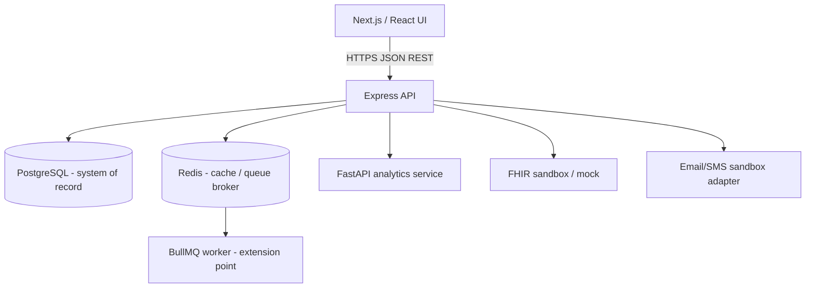

# Architecture and service boundaries

## Ownership
- **Express API** owns users, patients, departments, providers, appointments, encounters, diagnoses, prescriptions, lab orders/results, invoices, consent and audit records.
- **PostgreSQL** is the only authoritative persistence store for those entities.
- **FastAPI** accepts validated synthetic operational datasets and returns aggregate metrics. It does not own patient records and must not produce diagnoses or treatment recommendations.
- **Redis** is intended for ephemeral caching and retry-safe background job coordination. Do not use it as the source of truth.
- **FHIR** is an interoperability boundary. Map only synthetic records; preserve source identifiers and record exchange outcomes.

## Security model
JWT access tokens are short-lived. The refresh route is a minimal teaching example; production requires hashed refresh-token storage, rotation, reuse detection, revocation and secure cookie/client storage. Role middleware is server-side. Patient-level checks are implemented as a starting policy and must be completed for every resource and query. Never rely on the role-preview dropdown in the UI for security.

## Concurrency note
Appointment overlap is checked inside a database transaction, but this alone can still race under concurrent transactions without a database exclusion constraint or serialized locking strategy. For a stronger PostgreSQL implementation, add a `tstzrange` exclusion constraint per provider (requires a migration using raw SQL) and test simultaneous booking attempts. Document this as a critical hardening item before production.
